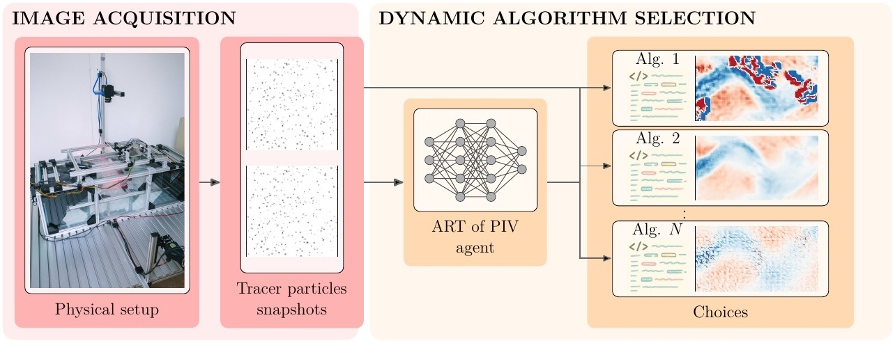

# ART of PIV: Agentic Real-Time Particle Image Velocimetry

This folder reproduces the results of the ART of PIV paper. ART of PIV
chooses the PIV estimator for each image pair: a lightweight learned agent
selects, from a library of estimators assembled for a speed budget, the one
it predicts to be most accurate, and returns that estimator's flow. The
estimator itself is `art_of_piv` in Flow Gym; see its
[API page](../../docs/api/estimators/art-of-piv.md).



## Experiments

Each folder reproduces one result of the paper and is named after it:
main-text results at the top level, appendix results in `appendix/`.

| Folder | Paper |
|---|---|
| [`table_1/`](table_1/) | Table 1 (main results; also the points of Figure 2) |
| [`appendix/A.1_learning_signal/`](appendix/A.1_learning_signal/) | Appendix A.1, Table 3 and Figure 8 (learning signal vs library size) |
| [`appendix/A.2_signal_parameters/`](appendix/A.2_signal_parameters/) | Appendix A.2, Figure 9 (bandit exploration) and Table 4 (regression target) |
| [`appendix/A.3_agent_architecture/`](appendix/A.3_agent_architecture/) | Appendix A.3, Table 5 (larger router) |
| [`appendix/B_library_selection/`](appendix/B_library_selection/) | Appendix B (greedy vs exact library selection; a script, not `run.py`) |
| [`appendix/C_raft_finetuning/`](appendix/C_raft_finetuning/) | Appendix C (the six RAFT32 specialists of the raft32 row) |
| [`appendix/E_epe_statistics/`](appendix/E_epe_statistics/) | Appendix E (per-frame EPE statistics of Table 1; a script, run after `table_1/`) |
| [`appendix/F.3_selection_agent_training/`](appendix/F.3_selection_agent_training/) | Appendix F.3 (water-channel selection agent: photometric augmentation ablation on a separate recording; data from `scripts/build_label_dataset.py`, see its README) |

The names follow the paper's numbering at the time of writing; they are
renamed once when the paper is final.

## Run

Once, install the GPU, W&B and Hugging Face extras and log in to the Hub:
the data come from the private datasets `activefluidcontrol/piv-class1`
(images and flow fields) and `activefluidcontrol/piv-class1-caches` (error
caches), both pinned to a revision.

```bash
uv sync --extra cuda12 --extra wandb --extra hf
uv run hf auth login
```

Then, from the repository root, on a GPU:

```bash
uv run python experiments/run.py --exp art_of_piv/<folder>
```

## Results

Each folder's results are in its `results.json` (or the file its script
writes); the tables in its README are generated from that file.

## Layout

```text
experiments/art_of_piv/
├── datasets/     # router training run (train.yaml) and the train/val/test splits
├── models/       # one file per estimator
│   ├── router/   # the ART of PIV routers: standard.yaml, fast.yaml, and
│   │             # regression.yaml, bandit.yaml for the other learning signals
│   ├── dis/      # DIS members, named after their knobs: ps9_st2_gd4_lv3.yaml
│   │             # = patch size 9, stride 2, 4 gradient-descent iterations, 3 levels
│   ├── openpiv/  # OpenPIV members, also named after their knobs
│   └── raft32/   # one RAFT32 per flow class, plus pretrained.yaml
├── libraries/    # fixed libraries: the model files a router selects from
├── pools/        # candidate pools the DIS and OpenPIV libraries are selected from
├── table_1/
└── appendix/
```
